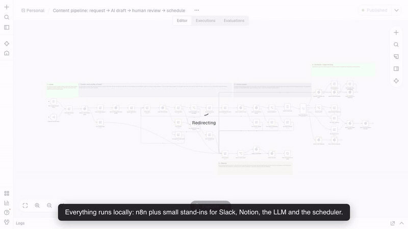
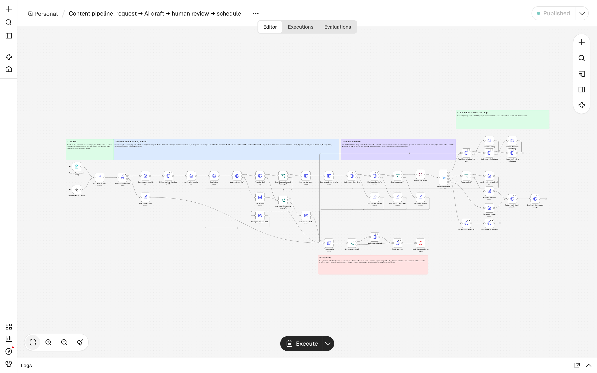
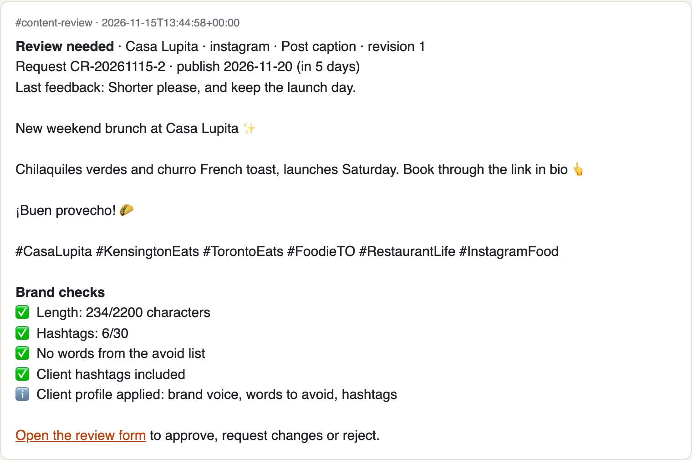
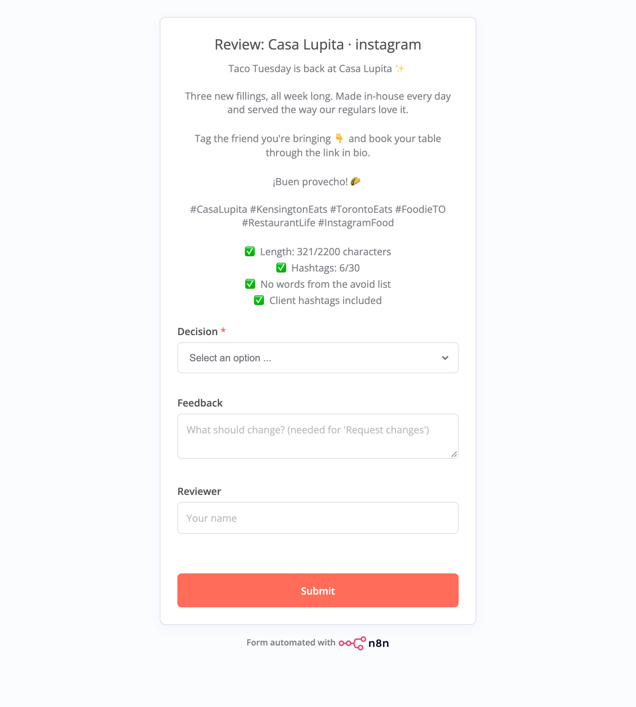
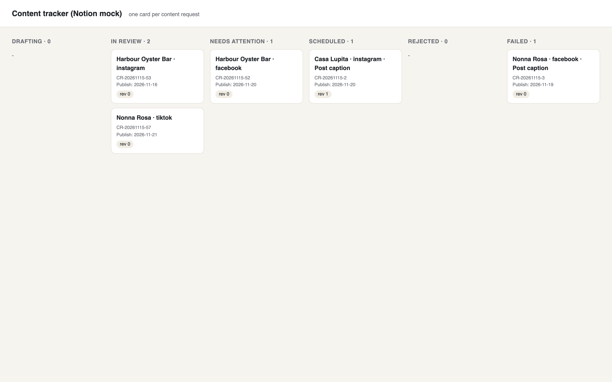
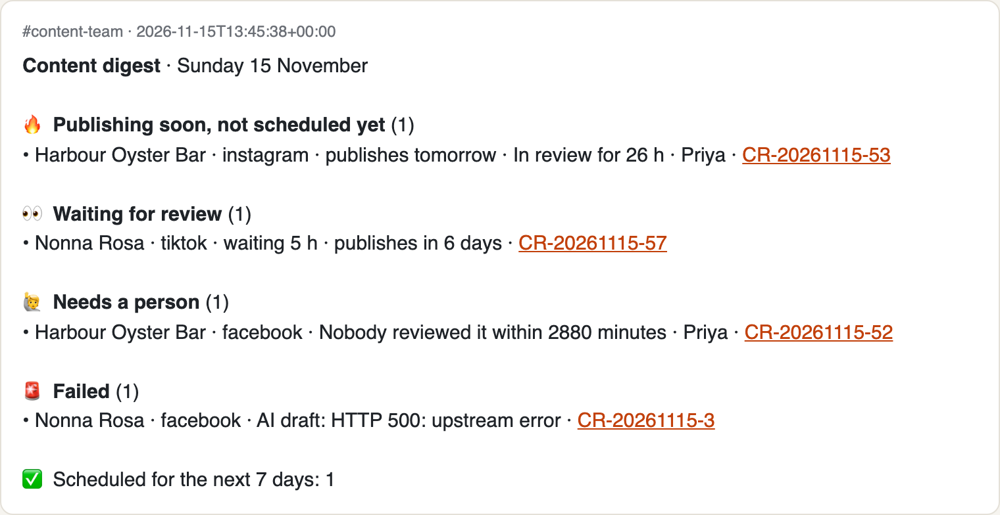
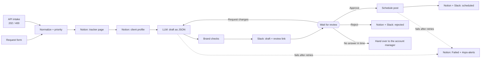
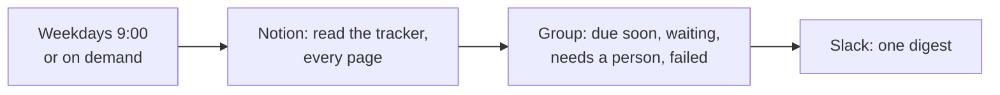

# Content pipeline for a creative agency (n8n)

[](https://github.com/juan-luca/n8n-content-pipeline/actions/workflows/e2e.yml)

n8n workflows that take a content request from an account manager to a scheduled post. The client's profile in
Notion shapes an LLM's first draft. The draft goes to Slack for a person to approve, loops on their feedback, gets
scheduled, and a Notion tracker follows it the whole way. Every weekday morning a digest in Slack shows what is about
to miss its date, what has waited too long for review and what needs a person.

Every external call retries, every failure is reported with context, and an end-to-end suite of 26 scenarios
drives the whole thing, outages included. It runs on every push.

It runs on a laptop with one command: n8n plus small local stand-ins for Slack, Notion, the LLM and the scheduling
tool. Pointing it at the real services is a matter of environment variables and credentials, not of editing the
workflows.



The full walkthrough, outage and daily digest included, is a 2:40 video: [docs/demo.mp4](docs/demo.mp4).



| Review message in Slack | Review form | Tracker |
|---|---|---|
|  |  |  |

| Daily digest in Slack |
|---|
|  |

## The problem

An agency producing a few hundred pieces of content a month for restaurants loses time in the gaps between people:
requests arrive by chat, drafts sit in someone's inbox, nobody knows what is approved or what is due tomorrow, and
when an automation breaks it breaks silently. The goal here is a pipeline where:

- every request is tracked from the moment it arrives, with its priority;
- the AI writes the first draft in each client's voice, but **nothing is published without a person's approval**;
- feedback goes straight back to the AI, so a revision takes minutes, not a day;
- deadlines, waiting reviews and hand-offs are visible every morning, without anyone chasing them;
- when something fails, the right channel hears about it with enough context to act.

## How it works





| Workflow | What it does |
|---|---|
| `content-pipeline.json` | The pipeline above. Starts from the request form or from the API intake. |
| `api-intake.json` | `POST /webhook/content-request` for other tools: validates the body, answers right away (202 with the request ID, or 400), then hands the request to the pipeline without waiting. |
| `ops-digest.json` | The daily digest: every weekday at 9:00 (or `POST /webhook/ops-digest`), one message to the team channel. |
| `error-handler.json` | Safety net for failures the workflows did not anticipate. It skips the ones they already reported. |

## Design decisions

- **Human in the loop by design.** The draft and the checks go to `#content-review` with a link to a review form
  (approve, request changes with a comment, or reject). The execution waits on n8n's Wait node, with no polling. If
  nobody answers within `APPROVAL_TIMEOUT_MINUTES`, the client's account manager is asked to take over instead of the
  request rotting.
- **Track first.** The Notion page is created before anything else, so a request is never lost, even if the AI or
  Slack is down. The status moves through Drafting → In review → Scheduled / Rejected / Needs attention / Failed.
- **Client knowledge lives with the team, not in the workflow.** Brand voice, default tone, words to avoid, hashtags,
  sign-off and account manager are a row per client in a Notion database that account managers already edit. The
  pipeline reads it on every request. A client without a row, or Notion being down at that moment, doesn't block
  anything: the draft is written from the request, and the reviewer is told why.
- **Priorities come from the date.** A request that publishes within `URGENT_WITHIN_DAYS` days is marked Urgent in
  the tracker and in the review message, so it gets looked at first.
- **One digest instead of more pings.** Instead of reminding people one by one, a single morning message groups what
  is due soon and not scheduled, what has waited for review and for how long, what needs a person, and what failed,
  each with a link to its tracker page. It reads the tracker page by page, the way the Notion API returns it, so it
  stays correct past 100 open requests.
- **A JSON contract with the model.** The LLM must return `hook`, `caption`, `hashtags`, `call_to_action`,
  `alt_text` and `visual_direction`. If the reply is not valid JSON, it gets one more try with a note about the
  format. If that also fails, the request is marked Failed.
- **Brand checks inform, people decide.** Length per platform, hashtag count, the words the client asked to avoid and
  the client's own hashtags are checked deterministically and shown to the reviewer with ✅/⚠️. They don't silently
  block anything.
- **Failures are loud and specific.** Every external call has 3 tries. If a step still fails, the request is marked
  Failed in Notion and `#ops-alerts` gets the step, the service's own error message, the request ID and a link to the
  execution. The execution is then marked failed with a `[handled]` message, so the error workflow doesn't send a
  second alert.
- **No Code nodes.** Everything is native nodes and expressions. That makes it easier to read and change for someone
  who isn't a developer, and less fragile across n8n upgrades.
- **Configuration outside the workflow.** URLs, channels and limits come from environment variables. Tokens live in
  n8n credentials, created by the setup script from `.env`, and never appear in the workflow JSON.

## Things n8n taught me while testing (n8n 2.47)

- **2xx answers with an `error` field count as failures.** The HTTP Request node treats a 2xx JSON response that has
  an `error` field as a failed call. Slack reports errors as HTTP 200 with `{"ok": false, "error": ...}`, so those go
  through the retries and the error output. An extra IF node still checks `ok` for responses without that field.
  Both paths are tested.
- **Pagination changes the error format.** A failed call normally reports `503 - "<escaped JSON body>"`. With
  pagination on, the body comes quoted but not escaped. The alert parser handles both, and a test checks that the
  digest's alert shows Notion's own message instead of raw JSON.
- **Form-triggered workflows can't respond to webhooks.** A workflow started by the Form Trigger can't contain a
  Respond to Webhook node. That's why the API entrance is its own small workflow that calls the pipeline.
- **The error workflow must be published.** In n8n 2.x it has to be published, or n8n won't run it.
- **Wait for readiness, not health.** `/healthz` answers before the database migrations finish. Running CLI imports
  at that moment can break the migration, so the setup script waits on `/healthz/readiness`.

## Run it locally

Requirements: Docker with Compose, Python 3, curl.

```bash
cp .env.example .env        # defaults run everything against the local mocks
./scripts/setup.sh          # starts the stack, loads credentials and workflows, publishes them
```

Then:

- open the request form at <http://localhost:5678/form/new-content-request> and send a request (try the client
  `Casa Lupita`, `Nonna Rosa` or `Harbour Oyster Bar`: they have profiles in the local Clients database);
- watch the review message arrive in the Slack mock at <http://localhost:8080/slack> and open its review link;
- follow the request on the tracker board at <http://localhost:8080/board>;
- post the digest now with `curl -X POST http://localhost:5678/webhook/ops-digest`;
- see every execution in the n8n editor at <http://localhost:5678>, using the owner account from `.env`.

API example:

```bash
curl -X POST http://localhost:5678/webhook/content-request -H 'Content-Type: application/json' -d '{
  "client": "Casa Lupita", "platform": "instagram", "content_type": "Post caption",
  "brief": "New weekend brunch: chilaquiles verdes and churro French toast, launches Saturday",
  "publish_at": "2026-12-05", "avoid": "best in town", "requested_by": "Maya"}'
# → 202 {"request_id": "CR-20261121-12", "status": "received", ...}
```

## Tests

`tests/run_tests.py` runs against the live local stack and uses it the way people and services would. Requests
come in through the form and the API, and reviews go through the review form. Outages are simulated with the mocks'
fault injection (`POST /__faults`). Publish dates are relative to today, so the suite doesn't go stale.

```bash
python3 tests/run_tests.py           # 26 scenarios, about 3 minutes (one waits for a real 1-minute review timeout)
python3 tests/run_tests.py --fast    # skips the timeout scenario
```

| Area | What is checked |
|---|---|
| Intake and review | Happy path from the API; the request form; invalid requests get a 400 and reach no service. |
| Review decisions | Feedback loop back to the AI; revision limit and review timeout hand over to the client's account manager; reject. |
| Client profiles | The profile shapes the prompt (voice, tone, words to avoid, hashtags, sign-off); unknown clients and a Notion outage fall back to the request. |
| Brand checks and priority | Words to avoid and missing client hashtags are flagged; requests due tomorrow are marked Urgent. |
| LLM failures | Errors retried; outage → Failed, with exactly one alert; invalid JSON gets one more try, then Failed. |
| Slack failures | `ok:false` with an `error` field (retries); `ok:false` without one (IF guard). |
| Scheduling and Notion | Scheduling errors retried, outage → Failed; a Notion outage still alerts, and no draft is written. |
| Daily digest | Due-soon, waiting, hand-off and failed requests in the right sections; every page of the tracker is read; an empty day says so; a Notion outage alerts once. |

Last run: **26 passed, 0 failed** (n8n 2.47.7). [GitHub Actions](.github/workflows/e2e.yml) runs the same setup
script and the same suite on every push.

The error workflow's alert branch only runs on failures the workflows did not anticipate, so the suite can't trigger
it on purpose. What it does check is the other half: failures the workflows handle don't produce a second alert.

## Going live

| Piece | What to change |
|---|---|
| LLM | `LLM_BASE_URL`, `LLM_MODEL`, `LLM_API_KEY`: any OpenAI-compatible chat completions endpoint. |
| Slack | `SLACK_API_BASE=https://slack.com/api`, a bot token with `chat:write`, and the bot invited to the review, alert and digest channels. |
| Notion | `NOTION_API_BASE=https://api.notion.com/v1`, an internal integration token, and the tracker and Clients databases shared with it ([schema](docs/notion-database.md)). |
| Scheduling | The mock is a generic stand-in. Connecting Buffer, Later or the Meta Graph API means adapting the one "Publisher: schedule the post" node. |
| Review links | `N8N_PUBLIC_URL` must be a URL the reviewers can open. |
| Digest time | Weekdays at 9:00 in `TIMEZONE`; the schedule is in the digest workflow's trigger. |

After changing `.env`, run `./scripts/setup.sh` again: it reloads the credentials and the workflows.

**Not done yet:**
- **Real accounts.** The suite only ran against the local mocks. Those mocks follow the Slack Web API and Notion API
  shapes (including typed properties, filters and cursors), but they are not the real services.
- **Images and video.** They travel as a link only.
- **Slack buttons.** They would need Slack interactivity and a public URL. The review form works without either.
- **Client name matching.** The profile lookup matches the exact client name; a select field fed from the Clients
  database would remove typos at the source.

## Repository

```
docker-compose.yml          n8n + mock services
.env.example                every setting, with local defaults
scripts/setup.sh            one-command setup (safe to run again)
workflows/                  the four n8n workflows (exported JSON)
mock/server.py              local Slack, Notion, LLM and scheduler (Python standard library)
tests/run_tests.py          end-to-end scenarios (Python standard library)
.github/workflows/e2e.yml   runs the setup and the suite on every push
docs/                       Notion database schemas and screenshots
```

Built by Juan Luca Santolíquido, with Claude Code as pair programmer. MIT licensed.
